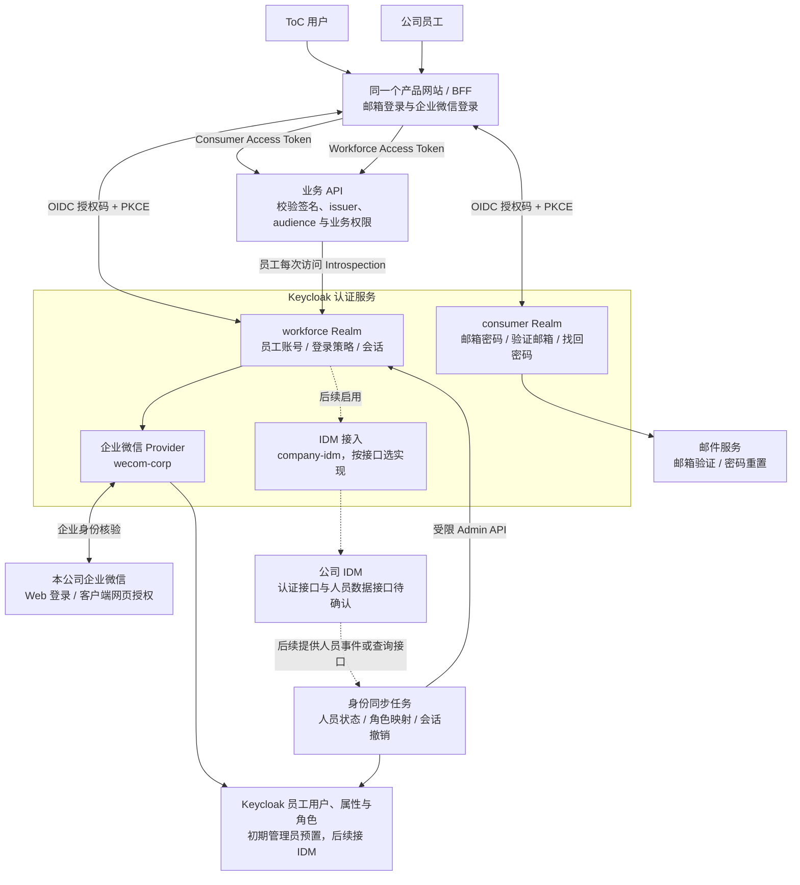
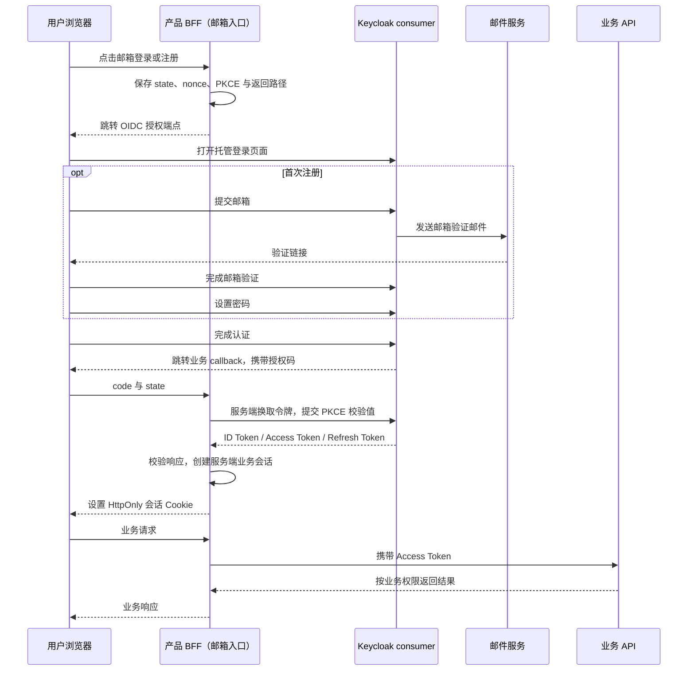
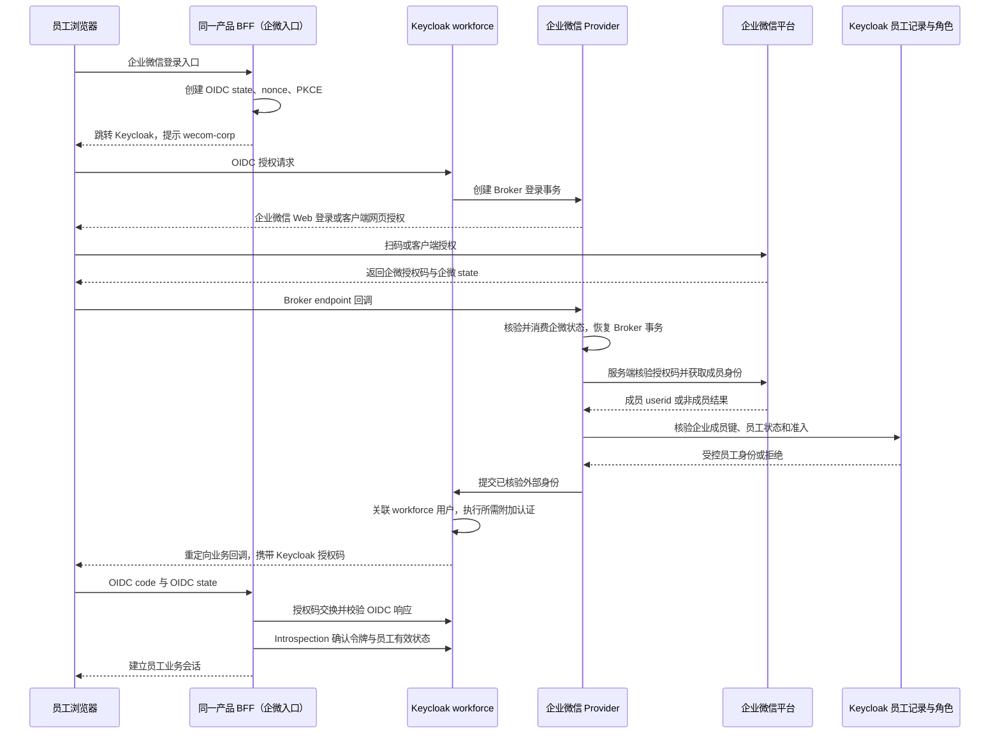
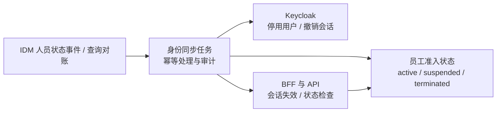

# ToC、企业微信与公司 IDM 统一登录设计

> 2026-11-12：当前实施以 [TapCanvas 统一平台计划](tapcanvas-platform-integration-plan.zh-CN.md) 为准。平台业务模块已演进为 platform-server，采用账号身份决定的单一积分策略；本文仅保留早期设计背景。

更新：2026-11-09。状态：首版本地实现已落地，真实企微、SMTP、公司 IDM 与生产部署待接入。实际代码与启动说明见 [定制模块 README](../../identity-platform/README.zh-CN.md)。

本文保留初期 ToC 与员工认证隔离的详细设计。**实际架构已升级为统一平台账号**：产品只接入 consumer，company 代理到 workforce，业务用户中心保存统一 userId。以 [统一用户中心设计](platform-user-center.zh-CN.md) 和定制模块 README 为当前实现依据。下面直接接入两个 Realm 的图、workforce-web 客户端与双回调是已被替代的初期方案，不应用于新集成。

已确认：ToC 第一版使用邮箱与密码，支持邮箱验证和找回密码；企业微信先服务本公司员工；公司 IDM 的接口可能为自定义接口，目前尚未确认。本文中的 `example.com` 均为待替换的示例域名。会话时间与同步频率为建议初值。

## 1. 设计决策

采用 Keycloak 作为统一令牌签发方，设置两个 Realm：

- `consumer`：公网 ToC 用户，自助注册、邮箱验证、找回密码。
- `workforce`：员工，通过本公司企业微信登录，后续接入公司 IDM；员工准入由受控名册和企业身份策略决定。

业务系统通过 OpenID Connect（OIDC）接入。第一版是一个 Web 产品，提供邮箱与企业微信两个登录入口，采用同一个 BFF：由业务后端完成授权码交换并保存令牌，浏览器保存业务会话 Cookie。BFF 可以是现有 Java/Go 业务后端中的认证模块。

企业微信通过独立的 Keycloak Identity Provider SPI 扩展接入，规划别名为 `wecom-corp`。当前检视的 Keycloak 源码没有内置企业微信 Provider。扩展编译、发布需与所选 Keycloak 正式版本匹配。

公司 IDM 接入方案在确认其接口后选择，预留别名 `company-idm`。员工通过企微和 IDM 认证后应关联到同一个 workforce 用户，保持其 Keycloak `sub` 和业务主键稳定。

Realm 提供账号与配置的逻辑隔离。同一集群中的两个 Realm 共享服务进程和数据库等基础设施；如后续要求公网与内网独立网络和故障域，可拆为独立部署。不同 Realm 的登录会话独立，员工单点登录发生在 `workforce` 内的各业务应用之间。

## 2. 整体架构



图中 OIDC 为业务系统与 Keycloak 之间的标准协议。企业微信与 IDM 的专用协议在认证接入层收敛，业务 API 按受控发行者校验 Keycloak 令牌。

## 3. 域名、入口与客户端

### 3.1 入口规划

| 地址 | 职责 |
| --- | --- |
| `https://app.example.com/` | 统一产品首页，提供邮箱登录、注册、忘记密码和企业微信登录 |
| `https://auth.example.com` | Keycloak 对外认证域名，承载两个 Realm 的认证页面及 Broker 回调 |
| `https://app.example.com/auth/login/wecom` | 企微专用业务入口，创建 OIDC 事务并设置 `kc_idp_hint=wecom-corp` |
| `https://app.example.com/auth/login/idm` | 后续 IDM 入口，设置 `kc_idp_hint=company-idm` |
| 产品的 `/login/oauth2/code/consumer` 与 `/login/oauth2/code/workforce` | 接收 Keycloak 授权码，由 Spring Security BFF 换取令牌 |

Keycloak 的 `master` Realm 用于平台管理。业务客户端放在上述业务 Realm 中；管理入口采用独立的访问策略。

### 3.2 客户端划分

| Realm | Client / 标识 | 用途与关键设置 |
| --- | --- | --- |
| `consumer` | `consumer-web` | BFF 保密客户端；Authorization Code、PKCE S256；精确配置回调地址 |
| `consumer` | `consumer-api` | API Audience 与业务 Client Roles 标识，通过 Audience Mapper 写入访问令牌 |
| `workforce` | `workforce-web` | 员工 BFF 保密客户端；Authorization Code、PKCE S256 |
| `workforce` | `workforce-api` | 员工 API Audience 与业务 Client Roles 标识 |
| `workforce` | `identity-sync`（未来） | 接通 IDM 后再创建的后台同步账号，授予所需最小管理权限 |

每个实际业务应用建立独立 Web Client，并根据需要建立独立 API Audience。普通 Web Client 关闭 Direct Access Grants、Implicit Flow 和服务账号能力。后台同步账号单独使用 Client Credentials。

客户端回调采用精确地址白名单。用户希望登录后到达的页面作为服务端事务的一部分保存，仅允许本站受控相对路径。`kc_idp_hint` 负责选择登录入口，权限仍由发行者、客户端、员工状态和业务规则共同决定。

## 4. ToC 邮箱登录方案

### 4.1 Realm 基线

| 配置 | 建议 |
| --- | --- |
| User registration | On |
| Email as username / Login with email | On |
| Duplicate emails | Off |
| Verify email | On |
| Forgot password | On |
| 语言 | 简体中文，保留英文作为可选语言 |
| 登录页面 | Keycloak 托管的品牌主题页面 |
| 邮件服务 | 生产 SMTP/事务邮件服务，配好发件域名与投递监控 |
| 防爆破 | 开启 Keycloak 登录失败保护，入口层补充 IP/账号维度限流 |

使用 Keycloak 自带的注册、验证邮箱、重置密码流程；业务后端保存业务用户资料和认证身份映射。密码由 Keycloak 负责保存与校验。

第一版网页交互通过跳转到品牌化的 Keycloak 页面完成。产品页面上的“邮箱登录”创建 OIDC 授权事务后跳转，而不是由业务后端收集密码再调用密码 Grant。

### 4.2 注册与登录

1. 新用户进入注册页面，填写邮箱。
2. 当前源码的原生流程先发送验证邮件，再引导设置密码；受保护业务以完成邮箱验证为准入条件。
3. 用户完成邮箱验证和密码设置后继续原登录事务；邮件在其他设备打开或事务已失效时，使用 Keycloak 原生恢复流程。
4. Keycloak 完成认证，将短期 OIDC 授权码返回业务 BFF。
5. BFF 使用授权码、PKCE 校验值及客户端认证换取令牌，校验 OIDC 响应后建立业务会话。
6. 业务按 `(issuer, sub)` 创建或查找业务用户，分配普通用户权限。



找回密码使用 Keycloak 邮件重置流程。入口层对重置请求、注册和重发验证邮件分别限流，对用户呈现一致的请求受理提示。实现时验证重置链接的过期/单次使用行为，并落实密码重置后的会话撤销策略。

修改邮箱走验证新邮箱的流程。业务主键保持不变，后端不以邮箱作为永久用户标识。

### 4.3 浏览器会话

BFF 服务端保存令牌，浏览器使用 `Secure`、`HttpOnly`、`SameSite=Lax`、Host-only 的会话 Cookie。建议使用 `__Host-` Cookie 前缀。OIDC 回调第一版使用顶层 GET 授权码回调；回调方式变化时重新校验 Cookie 策略。

回调对 `state` 一次性核验，并由成熟 OIDC 库验证 ID Token 的签名、`iss`、客户端 `aud`、`nonce` 和有效期。访问业务 API 使用 Access Token，按 API Audience 单独校验。验证密钥从预配置发行者的 JWKS 获取并支持轮换，发行者列表与算法由服务端配置。

所有有副作用的业务请求采用 CSRF 防护。BFF 的会话有效期不超过 Keycloak 会话与刷新令牌允许的范围，登录后更换业务会话标识。多副本 BFF 可使用 Redis 等共享会话存储；Keycloak 的集群缓存仍使用其自身支持的机制。

如果后续新增原生 App 或纯 SPA 客户端，单独规划 Public Client 与 PKCE，不把 BFF 客户端密钥分发到终端。

## 5. 本公司企业微信登录入口

### 5.1 用户体验与认证模式

| 场景 | 入口体验 | 上游认证方式 |
| --- | --- | --- |
| 普通桌面浏览器 | 点击“企业微信登录”，进入官方 Web 登录页面，可扫码或按官方支持的桌面端方式登录 | 企业微信 Web 登录，`login_type=CorpApp` |
| 企业微信客户端内 | 从员工入口或工作台打开页面，进入客户端网页授权 | 网页授权，基础身份使用 `snsapi_base` |
| 非本公司成员、外部联系人或未获准入人员 | 展示无访问权限及联系管理员入口 | 平台员工准入检查拒绝访问 |

第一版使用官方跳转式 Web 登录，后续可在员工页面内嵌官方 Web 登录组件。客户端内的授权是否需要交互，取决于企业微信权限、应用和会话状态。User-Agent 只用于选择展示/授权模式。

两种模式使用同一个 `wecom-corp` Provider 别名和同一套外部身份键，避免一个员工因桌面端和客户端内登录产生两个账号。

### 5.2 企业微信后台准备

由本公司的企业微信管理员创建自建应用，并准备：

- `CorpID`、`AgentID`、应用 Secret；Secret 通过部署密钥管理系统交付。
- 员工应用可见范围、Web 授权回调域、网页授权可信域名及所需域名校验文件。
- 按企业微信当前接口要求配置服务端可信 IP，并为 Provider 部署提供稳定出口。
- 工作台应用主页指向 `https://app.example.com/auth/login/wecom`。

企微回调地址规划为：

```text
https://auth.example.com/realms/workforce/broker/wecom-corp/endpoint
```

这是企业微信返回授权码的认证回调；业务 BFF 的 `/login/oauth2/code/{consumer|workforce}` 接收的是另一个由 Keycloak 签发的授权码。二者分别由对应认证层消费。

### 5.3 Provider 扩展职责

已在 `identity-platform/keycloak-extensions` 中实现 Provider，主要职责为：

1. 根据浏览器环境选择官方 Web 登录或客户端网页授权，带上服务端配置的 CorpID、AgentID 和受控回调。
2. 将企微 `state` 与 Keycloak Broker 认证事务绑定，校验有效期、会话和一次性消费。客户端内网页授权的官方 `state` 长度限制为 128 字节，并限制字符范围；建议使用 32 字节随机数的 64 位十六进制串定位受保护的服务端事务，再恢复并验证 Broker 状态。建议事务有效期 5 分钟，过期后重新发起登录。多副本时使用共享/集群一致的事务存储。
3. 回调后在服务端使用应用凭证获取调用凭证，再用企微授权码查询登录成员身份。调用凭证按返回有效期缓存，防止并发刷新；日志隐藏码、令牌和 Secret。
4. 校验接口成功状态，按当前官方响应结构解析成员 `userid`，以受控 CorpID 和成员标识组成外部身份键。
5. 执行员工准入检查：核对受控员工映射及有效状态，确认允许访问对应内部应用。
6. 创建 Brokered Identity，交给 Keycloak 完成用户关联、附加认证和令牌签发。

企业微信基础身份接口对企业成员可以返回 `userid`，非成员可能返回 `openid` 等字段。内部员工入口要求有效成员身份和平台准入记录。应用可见范围与返回成员标识都不能单独替代平台授权检查。

企微提供的是专用授权与身份接口，按其协议适配。这里采用 Identity Provider SPI，不把企微直接当作提供标准 OIDC Discovery、ID Token 的通用 OIDC 提供方。

### 5.4 员工准入与首次登录

第一阶段由管理员维护员工准入名册，至少包含平台员工主键、企业微信身份键、有效状态与应用授权。身份键来自可信的企业目录核对或管理员导入；用户自填邮箱和姓名仅作资料。

管理员在登录前创建 workforce 用户并绑定可信企微身份。首次登录只查找已批准的绑定，不自动创建或按邮箱合并用户。`workforce` 关闭自助注册，First Broker Login 配置为拒绝未关联身份。

员工资料中的邮箱允许缺失，避免企微未返回邮箱时阻断认证；已有员工身份通过稳定映射核验。员工业务角色由受控授权规则产生。第一版所有员工均在企微认证后完成 Keycloak TOTP；后续 IDM MFA 只有在语义核实和公司策略允许后才可替代。



## 6. 后续公司 IDM 接入

### 6.1 先区分认证与人员同步

| IDM 实际提供的能力 | 对接方案 | 需要确认 |
| --- | --- | --- |
| OIDC / SAML 单点登录 | Keycloak 内置 Identity Provider，别名 `company-idm` | 发行者、元数据、稳定 subject、MFA 和退出能力 |
| LDAP / AD 目录及认证 | User Federation / User Storage 接入 | 外部用户标识、读写策略及现有 workforce 用户迁移方式 |
| 登录跳转、一次性票据及服务端验票接口 | 独立 IDM Identity Provider SPI | 票据绑定、有效期、单次使用及身份结果可信性 |
| 只有用户名密码验证 API | 评估 User Storage / Credential 验证扩展，由 Keycloak 托管登录流程 | 接口契约、限流、超时、MFA、可用性及密码处理边界 |
| 只有人员、部门、在职状态查询 API | 用于员工名册同步；企微继续承担认证 | 增量更新、唯一员工标识、离职事件和全量对账 |

有人员查询接口并不代表 IDM 能完成登录认证。接口不明时，先保留上述接入选择，不假定它已经是 OIDC 服务。

如果公司 IDM 已统一支持企微认证，且公司要求所有员工认证都经过 IDM，优先采用“业务 → Keycloak → IDM → 企业微信”的链路，由 IDM 执行企业策略。

若保留 Keycloak 直连企微与 IDM 两个入口，两者必须满足相同的员工有效状态、应用准入和附加认证要求。IDM 要求唯一认证路径或特定安全校验时，企微入口应路由到 IDM，或执行公司批准的附加验证。

### 6.2 账号关联与迁移

1. 阶段一即要求管理员确认稳定且不可复用的 `employee_ref`，预置员工账号并关联企微身份。
2. IDM 接入前，通过可信名册对账，建立 `employee_ref`、企微身份与现有 Keycloak workforce 用户之间的映射。
3. 对已存在员工，在原 workforce 用户上增加 IDM 外部身份关联，保留 Keycloak 用户 ID、业务用户 ID 与原有权限。
4. 映射冲突进入人工核对；新员工在身份与准入均核验后再创建账号。
5. 首次登录流程按稳定身份映射关联用户。邮箱、手机号、姓名相同可用于提示核对，不能直接触发静默合并。
6. 同一自然人的个人 ToC 账号与员工账号保留各自权限边界。业务确需关联时，建立显式业务关联并验证双方控制权。

User Federation 的导入与存储策略可能影响用户 ID，选择 LDAP 路径时需要单独验证既有用户迁移，不能直接切换后假定 `sub` 不变。

### 6.3 离职、停用和退出

IdM 接通后，以其被确认的员工生命周期数据作为在职状态来源。同步模块先可放在现有业务后端，以定时任务和可用的变更事件运行。



员工停用时更新准入状态，停用 workforce 用户、撤销 Keycloak 会话并失效相应 BFF 会话。普通业务 JWT 离线验签不会自动查询最新人员状态，因此员工 API 在令牌校验之外还要核验员工有效状态。

当前实现：员工 BFF/API 每次访问执行 Keycloak Introspection，不缓存有效状态，无可确认的有效状态时拒绝内部访问。停用脚本禁用用户、移除 employee 角色并撤销会话。角色变更需要同时撤销会话，不能假定已有 JWT 中的角色立即更新。后续如引入短期缓存，应明确并验证撤权延迟。这个检查覆盖已有会话，而不只覆盖首次 Broker 登录。

状态事件送达平台后的传播目标可设为 60 秒内。公司源变更到平台收到事件的时间需要单独计入；如果 IDM 只有每 5 分钟轮询，不能承诺离职后 60 秒内全链路停用。上线前按实际能力确定并验证端到端时限。

业务退出先清除 BFF 会话，再执行 Keycloak OIDC 退出；多应用通过受支持的 Back-channel Logout 等机制失效各自会话。企微客户端和上游 IDM 会话是否同时退出取决于上游能力，需分别验证。

## 7. 身份与数据归属

| 数据 | 归属与主键 |
| --- | --- |
| ToC 密码、邮箱验证状态、MFA、认证会话 | Keycloak consumer |
| 员工本地认证档案与上游身份关联 | Keycloak workforce；外部认证凭据由上游维护 |
| 产品昵称、会员、订单、业务权限 | 业务系统 |
| 业务用户主键 | 业务系统生成的 UUID 等稳定主键 |
| 应用识别认证用户的唯一键 | Keycloak 的 `(issuer, sub)`，联合唯一 |
| 企微外部身份键 | 固定配置的 `(corp_id, userid)`；保留上游标识语义 |
| IDM 外部身份键 | 经确认的发行者/来源与稳定 subject；另存可信员工主键映射 |
| 员工准入与在职状态 | 初期 Keycloak 的 enabled、employee_ref、应用角色和预置 Broker 关联；后续由 IDM 同步更新 |
| 客户端密钥、企微 Secret、SMTP 凭据 | 部署密钥管理系统，仅服务端读取 |

业务侧认证映射建议包含 `business_user_id`、`issuer`、`subject`、账号域和业务状态。Keycloak 维护 Broker 外部账号关联；业务侧不另建一套可独立修改的同义绑定关系。

产品 API 显式信任 consumer、workforce 两个发行者，分别校验对应 Audience、签名和有效期。共同业务接受两类身份；员工能力额外要求 workforce 身份、employee 角色及有效会话。统一产品使用 PRODUCT_SESSION Cookie，后端按当前身份选择令牌、刷新与退出路径。

## 8. 会话与认证策略初值

| 项目 | consumer | workforce |
| --- | --- | --- |
| Access Token 有效期 | 5 分钟 | 5 分钟 |
| SSO Session Idle | 24 小时 | 30 分钟 |
| SSO Session Max | 7 天 | 8 小时 |
| MFA | 第一版按业务需要开启，后续可提供 Passkey/TOTP | 第一版所有员工要求 TOTP；IDM MFA 替代需另行核验 |
| 自助注册 | 开启，完成邮箱验证 | 关闭，按受控身份和准入开通 |
| 权限来源 | 默认普通用户权限与业务规则 | 准入名册、IDM 授权映射及业务规则 |
| 初期 Offline Access | 不申请 | 不申请 |

刷新令牌、BFF Cookie 和本地会话需受对应 SSO 生命周期约束。刷新令牌轮换使用成熟 OIDC 客户端库的并发管理与服务端存储能力，并验证重复使用行为。

普通用户登录不默认获得员工或管理权限。员工状态是业务访问条件，令牌有效期不等于离职撤权时限。密码重置、身份解绑、MFA 重置等动作的会话撤销行为列入验收。

## 9. 部署与代码组织

生产选定一个固定的 Keycloak 正式版本，构建包含定制主题及 Provider JAR 的镜像。应用扩展通过独立模块维护，按所选版本执行兼容测试。认证域名保持稳定，避免后续更换 issuer 导致身份映射失效。

首个验证环境可单副本部署。生产可采用两副本 Keycloak、外部 PostgreSQL、TLS 反向代理、事务邮件服务及按需配置的 BFF 会话存储。代理按固定对外域名配置，并只接受来自受信代理的转发头。管理端访问、凭据备份和升级回滚纳入部署设计。

工程已落在现有 Keycloak 根目录，并由根 POM 的模块列表聚合；定制模块保留自己的依赖管理，也可以单独构建：

```text
keycloak/identity-platform/
├── keycloak-extensions/        企微 Provider、员工准入、改密撤销会话
├── theme/                      中文主题 JAR
├── dev-launcher/               IDEA 启动入口，加载扩展和主题
├── demo-web/                   单个 Spring Boot BFF/API，邮箱和企微两个登录入口
├── realm-config/               Realm 安全基线
├── scripts/                    初始化、员工维护、启动与停止
├── integration-tests/          浏览器与协议测试
├── postman/                    接口契约、企微模拟器、接口集合
├── compose.yaml                本地 PostgreSQL 与 Mailpit
└── README.zh-CN.md             使用与验收说明
```

员工准入数据直接存储在 Keycloak，扩展运行在 Keycloak 进程内；第一版不增加员工目录微服务或独立身份数据库。Spring Boot 只是业务接入示例。IDM 未提供契约，因此没有虚构可用的 IDM Provider 或同步任务。

## 10. 实施顺序与验收

### 阶段一：上线 ToC 基线

配置 `consumer`、邮件服务、中文主题和一个实际 Web Client，完成 BFF 接入。验收注册、邮箱验证、登录、找回密码、修改邮箱、刷新与退出；同时验证错误 Audience、错误 issuer、错误回调和失效授权码被拒绝。

### 阶段二：上线本公司企微入口

建立 `workforce` 和员工准入名册；开发并安装企业微信 Provider；配置自建应用的授权域名、IP 与工作台主页。

验收：

1. 桌面 Web 登录与企微客户端内网页授权定位到同一个员工账号。
2. 非企业成员、仅返回外部联系人身份、未入准入名单、停用员工均被拒绝。
3. 伪造/过期/重放 `state`，或过期/重放企微 code，被拒绝。
4. 企微回调与业务 OIDC 回调各自校验对应事务。
5. 两个服务副本之间能完成状态校验，应用调用凭证并发刷新可控。
6. consumer 的 Token 无法通过员工 API 的 issuer、Audience 和角色校验。
7. 高权限操作满足配置的附加认证；账号资料中的邮箱缺失不会诱导生成虚假邮箱。

### 阶段三：接公司 IDM

先拿到登录认证与人员生命周期两份接口契约，按第六节选择接入方式，再执行账号对账、受控绑定和灰度接入。

验收 IDM 与企微定位同一员工，原业务主键保持稳定；冲突身份不静默合并；离职、停用、角色回收在约定端到端时限内生效；验证 IDM 不可用时的明确行为及员工入口是否符合公司认证策略。

### 阶段四：生产验证

按实际登录量验证邮件投递、限流、数据库与会话容量；演练多副本登录、Keycloak/Provider 升级回滚、签名密钥轮换、上游异常及身份状态同步重试。

## 11. 真实环境接入前待补充的信息

- 产品正式域名、前端形态与业务后端框架，用于落地 BFF Client、Cookie 和回调配置。
- 事务邮件服务及品牌发件地址。
- 企业微信自建应用的管理员配置、受控员工名单、生产回调域名和出口 IP。
- 公司 IDM 的认证协议/验票或密码验证接口，与人员查询/变更通知接口。
- 公司稳定员工标识、员工准入规则，以及 IDM 是否要求成为唯一认证路径。

上述信息用于把设计转成可执行配置。Secret、密码和私钥通过实际环境的密钥管理渠道交付。

## 12. 依据与资料

设计选择与时间参数由本方案提出；产品能力依据本地源码及以下官方资料核对。企业微信开发者页面已于 2026-11-05 通过公开页面读取，实施时继续以企业后台实际开通权限与当前接口契约为准。

- [Keycloak OIDC 接入与端点](https://www.keycloak.org/securing-apps/oidc-layers)
- [Keycloak 管理与身份代理说明](https://www.keycloak.org/docs/latest/server_admin/)
- [Keycloak Provider 配置](https://www.keycloak.org/server/configuration-provider)
- [企业微信 Web 登录组件与跳转参数](https://developer.work.weixin.qq.com/document/path/98152)
- [企业微信 Web 登录身份获取](https://developer.work.weixin.qq.com/document/path/98176)
- [企业微信客户端内网页授权链接](https://developer.work.weixin.qq.com/document/path/91022)
- [企业微信网页授权身份获取](https://developer.work.weixin.qq.com/document/path/91023)
- [腾讯云官方企微接入配置示例](https://cloud.tencent.com/document/product/1441/107281)
- 本地源码：[AbstractIdentityProvider.java](C:/Users/shizizhao/code/keycloak/server-spi-private/src/main/java/org/keycloak/broker/provider/AbstractIdentityProvider.java)、[IdentityProvider.java](C:/Users/shizizhao/code/keycloak/server-spi-private/src/main/java/org/keycloak/broker/provider/IdentityProvider.java)：Broker SPI 与回调契约。
- 本地源码：[IdentityBrokerService.java](C:/Users/shizizhao/code/keycloak/services/src/main/java/org/keycloak/services/resources/IdentityBrokerService.java)、[IdentityProviderAuthenticator.java](C:/Users/shizizhao/code/keycloak/services/src/main/java/org/keycloak/authentication/authenticators/browser/IdentityProviderAuthenticator.java)：外部身份回调、关联与登录入口选择。
- 本地文档：[first-login-flow.adoc](C:/Users/shizizhao/code/keycloak/docs/documentation/server_admin/topics/identity-broker/first-login-flow.adoc)：首次登录与账号关联规则。
