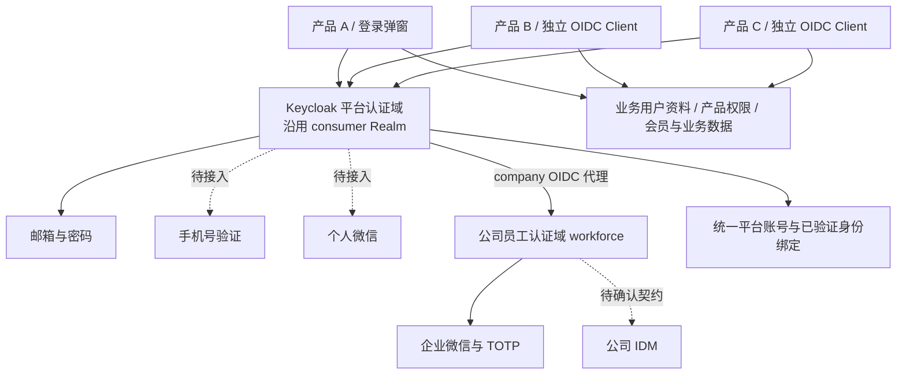

# 统一平台账号、多种登录方式与跨产品 SSO

> 2026-11-12：TapCanvas 接入和积分规则以 `tapcanvas-platform-integration-plan.zh-CN.md` 为准。每账号只有一个 EMPLOYEE/CONSUMER 积分策略；旧双余额设计已取消。本文件保留早期账号/SSO 背景。

更新：2026-11-09。本文记录统一账号设计与已落地的第一版实现。当前实现的运行方式仍以 `identity-platform/README.zh-CN.md` 为准。

## 产品目标

产品页点击登录，显示统一登录弹窗，选择邮箱、个人微信、手机号或企业身份等方式。完成经过验证的绑定后，不同方式登录到同一个平台账号，看到同一份个人资料及相应业务数据。以后增加产品 B、C，已有认证会话可用于单点登录。

登录方式、平台账号、产品和员工权限是四个不同概念。登录方式不应分别对应独立产品或独立公共用户库。会员、积分、订单是否跨产品共享由业务规则决定，SSO 本身不授予其他产品的权益。

## 目标模块关系

图中的虚线表示尚未完成的接入。保留现有 consumer 的 issuer 可避免无必要地变更身份主键；“平台认证域”是职责说明，不要求立即重命名 Realm。

## 账号与数据归属

| 职责 | 放在哪里 |
| --- | --- |
| 密码、验证邮件、外部登录绑定、认证会话与令牌 | Keycloak |
| 平台用户 ID、昵称、头像、业务状态与认证身份映射 | 业务后端的用户中心模块 |
| 会员、订单、积分、产品权限 | 对应业务模块，按平台用户 ID 关联 |
| 员工身份、企业 TOTP、在职状态与 IDM 对接 | workforce 认证域及受控生命周期同步 |

用户中心可以先放进现有业务后端，无需新增独立微服务。认证身份用 `(issuer, sub)` 唯一定位，业务用稳定平台用户 ID；邮箱和手机号可变，不作为永久主键。

个人邮箱、手机号、个人微信应关联到同一平台认证用户。新增登录方式需要验证其控制权；如果发现已有账号，走明确的绑定/冲突处理流程，不因同名或同邮箱自动合并。

截图中的个人微信/公众号登录与当前企业微信员工登录是不同的上游接入。现有代码没有接入个人微信、手机号或 QQ。

## 跨产品登录

每个产品在同一平台认证域建立独立 OIDC Client、回调白名单与 API Audience。产品 A 登录时建立 Keycloak SSO 会话及 A 自己的业务会话；访问 B 时，由 B 发起自己的授权请求。会话有效且无额外认证/授权要求时，Keycloak 直接返回属于 B 的授权码，B 换取自己的令牌并建立自己的会话。

产品各自持有业务 Cookie，不复制 A 的令牌到 B，不通过共享密码实现免登录。浏览器场景优先采用标准顶层重定向；跨浏览器、原生 App、第三方 Cookie 限制和增强认证策略需要单独验收，不能承诺任何场景都无交互。

## 登录弹窗

弹窗属于产品 UI，提供登录方式选择。第一版继续使用 OIDC Authorization Code + PKCE、BFF 服务端保存令牌；Keycloak 登录页可以定制品牌主题，授权完成后恢复原产品页面。

如果要求扫码和邮箱输入均完整留在产品内嵌弹窗，需要另行设计对应上游的扫码能力、浏览器窗口通信和认证会话管理。不能把“画出弹窗”当成已完成认证协议接入；不能通过简单 iframe 或改用密码 Grant 来假定获得完整 SSO。仅展示已经接通的登录方式。

## 企业身份与同一平台账号

consumer 已通过 OIDC 代理 `company` 接入 workforce。用户先注册验证平台邮箱，再通过原生 `kc_action=idp_link:company` 证明两侧账号控制权并绑定；无自动创建或按邮箱合并。绑定冲突由 Keycloak 拒绝。

企业功能每次检查已绑定员工、平台会话中的已验证上游 sub/sid、员工当前启用/角色/employee_ref 及有效上游会话。证明只存会话备注。单纯邮箱登录不授予企业权限；停用不等待 JWT 到期。独立个人会话与企业会话的撤销分别验收。

## 已完成的本地第一版

- 产品登录弹窗：邮箱、企业微信两个入口，桌面与手机布局。
- 平台账号统一使用 consumer，员工域作为企业认证上游。
- UserCenter 内嵌业务示例，PostgreSQL 单独 schema 与数据库角色，统一 userId 和昵称。
- 原生 Keycloak 绑定、冲突拒绝、邮箱登录和企微登录映射同一用户。
- 产品 B 使用独立 Client / Audience / Cookie，验证 SSO、资料同步和退出传播。
- 真实 Keycloak / Spring Boot / PostgreSQL 参与本地验收，只有企微上游使用 Postman 模拟。

完整运行步骤和当前验证结果见 [模块 README](../../identity-platform/README.zh-CN.md) 与 [验收记录](../../identity-platform/VALIDATION.zh-CN.md)。个人微信、短信、真实企业微信凭据和 IDM 接口仍待接入。当前没有头像上传、会员系统、业务订单或自动合并历史账号功能。

## 公开依据

- [淘宝与淘宝闪购账户绑定协议](https://terms.alicdn.com/legal-agreement/terms/suit_bu1_taobao/suit_bu1_taobao201904021518_75354.html)公开说明了绑定后的快捷登录、免登跳转和部分服务互通；没有据此推断其内部使用 Keycloak 或 OIDC。
- [Keycloak 管理文档](https://www.keycloak.org/docs/latest/server_admin/index.html)说明 Realm、Client、身份代理及账号绑定能力。
- [Keycloak JavaScript adapter](https://www.keycloak.org/securing-apps/javascript-adapter)说明 SSO 检测与现代浏览器限制；当前 BFF 方案并不要求把令牌交给前端 adapter。
