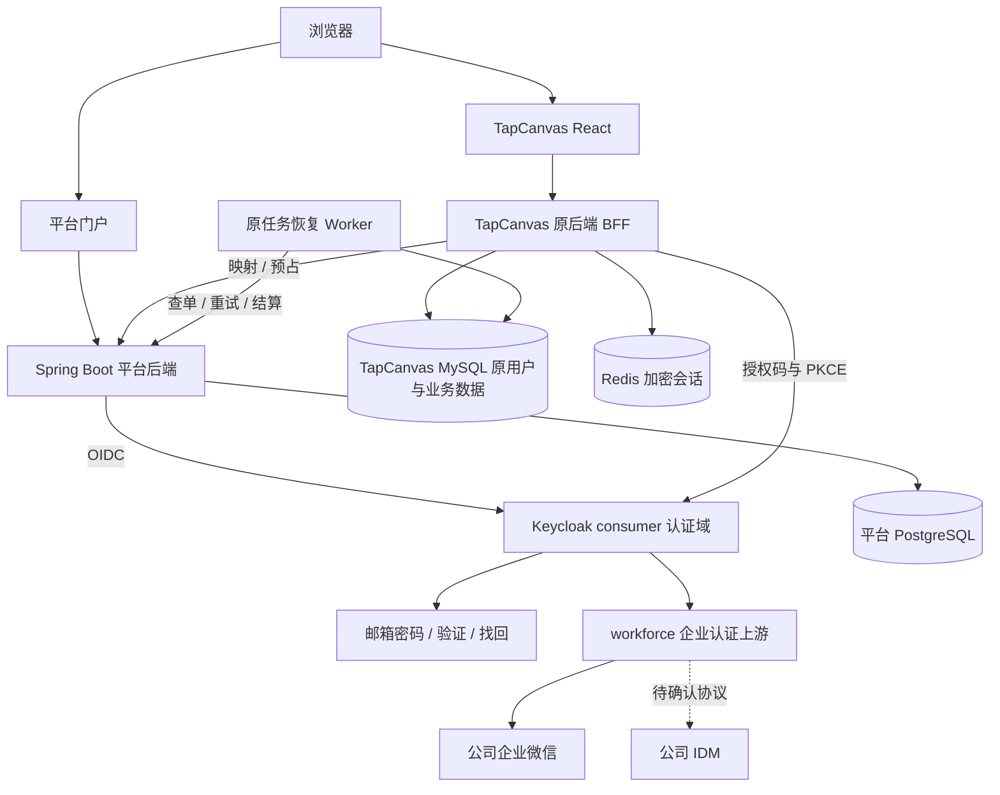

# Keycloak 统一账号、门户与 TapCanvas 接入

2026-11-12 用户批准的实施基线，替代此前双余额与补差设计。

## 目标和规则

Keycloak 负责认证；平台负责统一用户、应用授权、积分和门户。第一款真实产品为 TapCanvas。保留原平台用户 ID、TapCanvas `users.id`、所有业务数据与业务权限。旧积分不结转；旧流水和任务证据保留。

| 规则 | EMPLOYEE | CONSUMER |
|---|---|---|
| 唯一余额 | 员工个人额度 | 长期个人积分 |
| 刷新 | 原配置时刻，Asia/Shanghai，每日一次 | 不重置 |
| 申请 | 原会员规则，立即/延迟/人工审批 | 服务端拒绝 |
| 不足 | 申请额度，不从其他余额补扣 | 提示不足及开放的获取方式 |
| 首次发放 | 批次确认的员工额度 | 独立配置，默认 0 |

策略跟随账号身份，不跟随登录方式。所有获准产品共享账户、刷新、申请统计和账本。绑定不会重置或重复发放。员工停用后阻止新的企业访问和消费，不自动降级为 ToC。管理员变更策略前必须核对在途操作、封存旧账、再开目标策略账本。

## 架构

工程在 Keycloak 根部 `identity-platform` 聚合项目：`keycloak-extensions`（企微 SPI、身份校验）、`theme`（中文认证和邮件）、`dev-launcher`（IDEA）、`platform-server`（原 demo-web 演进，用户/应用/组织/积分/门户）、`postman/specs`（契约）、`scripts`（迁移和配置）、`integration-tests`（验收）。

沿用 Java 21、现有 Spring Boot/Security/JDBC、PostgreSQL，数据库迁移采用 Flyway。TapCanvas 保留 React、Node/NestJS/Hono、MySQL、Redis/BullMQ。不升级 Keycloak 大版本，不把业务账本放入 Keycloak 内部表。

## 身份、会话和迁移

`Keycloak (issuer,sub) → platform_user.id → (app_id,local_user_id) → TapCanvas users.id → 原业务数据`。

- 每产品独立 Web/服务 Client；授权码、PKCE、state、nonce、精确回调白名单。令牌保留服务端，浏览器 HttpOnly/SameSite Cookie，写请求校验 Origin/CSRF。TapCanvas Redis 会话 AES-GCM 加密。
- 校验 issuer/audience/azp/有效期、会话和账号状态。内部接口另校验 scope、产品登记和操作归属。原业务权限仍由 TapCanvas 检查。
- RP-Initiated Logout + Back-Channel Logout；员工新消费及延迟到账前检查当前上游资格。上游不可用时拒绝新授权，已授权任务仍可结算。
- 企微按已验证 `(tenant_id/corpId, subject/userid)` 预关联 workforce/consumer；不得混用命名空间。无邮箱的已核验员工可直接扫码。
- 密码源格式：PBKDF2-HMAC-SHA256，210000 次，UTF-8 密码与 UUID 文本盐，256 位输出；十六进制摘要转换为 Keycloak 原生格式。导入前验证 ASCII、中文、非 BMP 字符及错误密码。报告不包含密码或凭据。
- 同邮箱/同名不自动合并。冲突、未知身份、禁用记录明确分类，遇到错误不能新建账号规避。
- `migrationReady=false` 时未知用户不能创建产品账号；旧账号处理完成后才开放新用户映射。
- `platform.integrate` 服务同时携带用户令牌解析账号/预占；API Key 后端调用须额外 `platform.delegate` 且产品显式开启，先校验原产品权限、解析既有用户映射，再检查当前身份。浏览器不能指定他人平台 ID 扣费。

## 积分与任务

平台是生效余额唯一写入方。金额为 BIGINT 最小单位，接口用十进制字符串；兼容 TapCanvas 数值 UI 时检测安全整数范围，超限显式报错，不舍入。周期桶、策略 epoch、不可变流水分开保存。

- 流水包含期初、刷新、申请、调整、冻结、结算、释放、退款、过期、封存和迁移批次。
- `(app_id,operation_id)` 唯一；重复事实返回原结果，改变金额/摘要/上下文/终态证据返回冲突。
- 固定价：本地持久化意图 → 远程预占 → 确认后提交供应商 → 成功结算/权威失败释放。超时查单或重试，不能推断失败。
- 文本 token：保留后付费，正余额准入、预占金额 0，按原周期可用额扣至 0，记录应收/实收/未收并保护其他冻结。
- 跨周期仍结算原桶。旧周期有未决文本任务时保留已授权的原周期后付费能力，不花新周期额度；全部终态后过期剩余。
- 作品与结算意图先在 TapCanvas 本地事务落盘，远程请求在事务和数据库写入槽之外执行，由现有 finalizer 重试。未知供应商状态不可仅凭超时再生成或释放。
- `credit_authority` 固化到任务：旧 LOCAL 任务由旧账本收口，PLATFORM 任务由平台收口。切回配置不改变已有归属。供应商余额仍是独立成本/容量约束。
- 退款回原消费桶；已过期或封存桶不能转换为另一策略余额。

TapCanvas 申请规则经源码核对：当天序号统计所有申请；自动金额限额只累计立即/延迟申请。超过单次/每日自动限额转人工；关闭自动规则仍可申请并转人工。平台按用户跨产品统计，延迟重试不重复到账。

## 接口与交付

契约：`identity-platform/postman/specs/platform.yaml`。用户接口 `/v1/me`、其下 `/applications`、`/wallet`、`/wallet/ledger`、`/credit-requests`；产品接口 `/internal/v1/app-accounts/resolve`、`/wallet/reservations`、`/wallet/operations/{id}` 及 settle/release/query；管理接口限定 `platform.manage`，覆盖应用、批次导入、组织成员、启停、资格刷新、策略、额度、审批、调整和退款。

| 阶段 | 交付 | 验收 |
|---|---|---|
| P0 | 本设计、只读审计、密码/身份/积分报告、OpenAPI/批次格式 | 历史记录分类明确，冲突不静默跳过 |
| P1 | 映射、策略、应用目录/授权、Clients | 并发唯一映射、重复导入幂等 |
| P2 | OIDC、预关联、凭据导入、退出/停用 | 邮箱/企微/无邮箱员工 ID 不变，原数据权限可见 |
| P3 | 单策略账本、刷新、申请审批、消费退款 | 并发/重放/跨周期/停用准确，ToC 不刷新不申请 |
| P4 | 任务归属、事务意图、重试对账 | 不双扣、不丢作品，未知结果待核实 |
| P5 | 企业/ToC 门户、卡片、余额/申请/流水 | 两个入口回原用户，显示与账本一致 |
| P6 | 构建、IDEA、备份/切换/恢复演练 | 测试环境通过，输出可核对批次 |

当前进度和实测证据在聚合项目 `IMPLEMENTATION.md`；编译通过不等于迁移验收通过。

## 切换与恢复

1. 只读审计，核对源快照、目标 issuer、应用、版本、批次摘要、冲突和禁用列表。
2. 暂停旧注册/改密/绑定，最终导出逐条导入，先切账号，积分保持 local。
3. 验证原邮箱密码、企微、无邮箱、停用、冲突；抽验业务 ID/权限、SSO 与退出。
4. 短暂停止新付费任务和旧额度发放，记录在途所属账本。旧任务及流水留档，未收口任务继续 LOCAL。
5. 新账本按确认规则幂等开账，旧余额不结转；开启 PLATFORM 新任务，恢复入口并持续对账。
6. 新消费或改密后恢复必须核对新账本与最新凭据，不能仅切回旧配置；不得一键删除业务数据。

本轮包含本地开发、自动化测试、迁移工具与隔离演练。正式导入/切流使用已核对的目标环境、备份和具体批次。后续 IDM 协议待确认；本期不增加支付、个人微信或短信入口。
