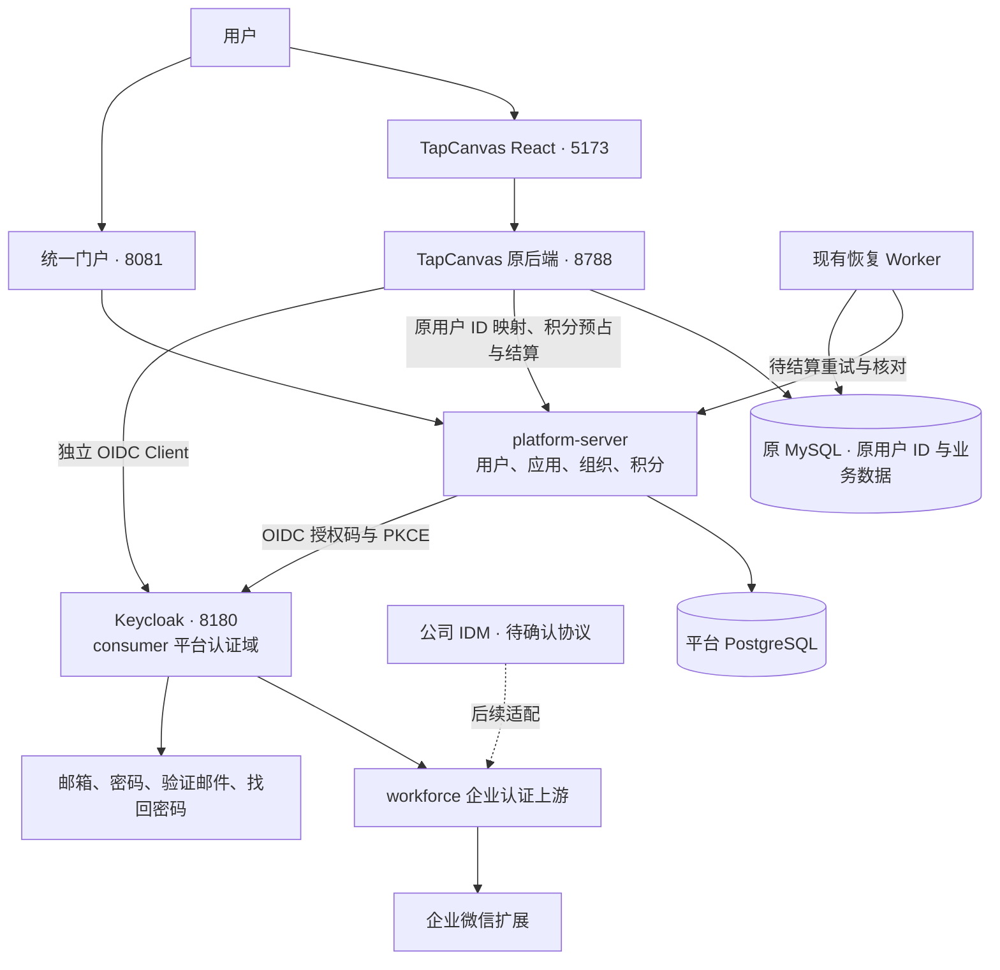

# 统一账号、应用门户与积分中心

`identity-platform/` 是 Keycloak 根 Maven 工程的聚合子模块。当前实现遵循 2026-11-12 方案：一个平台用户、一种生效积分策略，首个接入产品为 TapCanvas。身份迁移和积分切换分两步执行。

## 架构与模块



```text
identity-platform/
├── keycloak-extensions/  企微 SPI、员工准入、身份绑定、会话与资格检查
├── theme/                中文邮箱注册、登录、验证、找回密码页面
├── dev-launcher/         IDEA 中启动当前源码版本 Keycloak
├── platform-server/      由 demo-web 演进；Spring Boot 业务后端与门户
│   └── src/main/
│       ├── java/local/identity/demo/account/ 用户映射、应用与管理接口
│       ├── java/local/identity/demo/wallet/  积分、申请、周期规则与后台处理
│       └── resources/db/migration/          PostgreSQL Flyway V1–V7
├── scripts/              配置、迁移、开账、隔离演练工具
├── integration-tests/    浏览器和 HTTP 验收
├── postman/              OpenAPI、本地测试集合、企微模拟
└── .local/               私密配置、审核批次、演练证据；Git 忽略
```

包名保留 `local.identity.demo`；入口已改为 `PlatformApplication`。企微扩展运行在 Keycloak 内；积分和产品数据不放入 Keycloak 的内部表。

## 账号与积分规则

`issuer + sub → 原平台用户 ID → app_id + TapCanvas users.id → 原业务数据`。邮箱、姓名不是自动合并依据。审核过的企微 `(corpId, userId)` 可以预关联，无邮箱员工无需先注册邮箱。PBKDF2-SHA256 210000 次、UTF-8 字符串盐、32 字节结果的历史密码可原样兼容导入；其他格式阻止导入并要求处理。

| 策略 | 可用积分 | 刷新与申请 |
| --- | --- | --- |
| EMPLOYEE | 员工个人额度，各获准产品共享 | 上海时区配置时刻刷新；即时、延迟及人工审批沿用审核后的会员规则 |
| CONSUMER | 长期个人积分，各获准产品共享 | 不自动刷新；不能自由申请；首次赠送默认 0 |

邮箱或企微登录不会改变账号策略、重复发放积分或创建另一笔余额。员工停用后拒绝新的企业访问和额度使用；已提交任务仍允许完成结算或释放。账号类型变更必须经过受控管理接口，核对在途任务、封存旧账，再按目标策略开账。

平台是新账本唯一写入方。旧积分不结转，旧流水不删除。固定价先预占，成功扣费，权威失败释放；供应商状态未知不因超时退款或重新生成。文本沿用后付费，记录应收、实收及未收差额，扣至零后拒绝新的付费请求。

## IDEA 启动顺序

前提：Java 21、Maven、Python 3、Docker Desktop、PowerShell 7，当前 Keycloak `999.0.0-SNAPSHOT` 依赖已安装到本地 Maven 仓库。

1. IDEA 打开 Keycloak 根目录，Reload Maven，SDK 选择 Java 21。
2. 在 `identity-platform` 执行 `./scripts/setup.ps1`，准备 PostgreSQL、Mailpit 并构建定制模块；再执行 `./scripts/install-idea.ps1`。
3. 启动 **Identity Keycloak**：`local.identity.IdentityKeycloakDev`，等待 `http://127.0.0.1:8180` 就绪。
4. 首次配置或升级后执行：

   ```powershell
   python scripts/identity_admin.py initialize
   python scripts/platform_setup.py --web-origin http://127.0.0.1:5173 --api-origin http://127.0.0.1:8788 --portal-origin http://127.0.0.1:8081
   ```

5. 启动 **Identity Platform**：`local.identity.demo.PlatformApplication`，访问 `http://127.0.0.1:8081`。工作目录是 `identity-platform`，读取 `.local/demo-product.properties`。
6. 平台就绪后执行 `python scripts/platform_setup.py --register-application`。重复执行会保留已有应用的迁移及访问设置。
7. TapCanvas 按原开发方式启动 MySQL、Redis、后端及 Worker、前端。后端合并 `.local/tapcanvas.identity.env` 的专用配置；详见 TapCanvas 的 `docs/identity-platform-integration.md`。不要把平台运维密钥复制给产品。
8. 完成审核和身份迁移后再用原产品账号验收；默认 `migrationReady=false`，缺少映射时阻止建号。积分开账与计费切换另行执行。

**Identity Product B** 只是可选 SSO 示例，不是 TapCanvas 的依赖。修改业务后端可直接重启；修改 SPI 或主题需重新安装对应 JAR 再重启 Keycloak，无需每次重建全部源码。

`./scripts/start.ps1` 可启动平台开发环境；`./scripts/stop.ps1` 只停止脚本管理的进程，IDEA 进程自行在 IDEA 停止。启动脚本不会导入 TapCanvas 用户、应用 MySQL 迁移或开启统一积分。

## 登录、绑定和管理

邮箱注册后先验证邮箱再设置密码。开发邮件在 `http://127.0.0.1:8025`；找回密码会撤销旧会话。管理员没有固定默认密码，现有本地凭据在忽略的 `.local/settings.json` 中。

已有平台用户可以在账号中心主动绑定公司身份，必须证明两侧归属；历史员工由迁移批次预关联。未核验的公司身份不会按邮箱自动建号或合并。绑定不调整积分策略。

统一产品访问检查账号策略及员工有效资格；旧示例 `/api/employee/*` 额外要求企业会话证明。后台任务使用受限服务身份检查账号及企业资格，不要求浏览器在线；终态结算不因用户离职而丢失。

```powershell
python scripts/identity_admin.py employee --ref employee-003 --userid real-userid --state active
python scripts/identity_admin.py employee --ref employee-003 --userid real-userid --state suspended
```

真实企微需本公司 CorpID、AgentID、Secret、回调和批准的成员映射。清空模拟地址、关闭 mock 并注入 Secret 后，须在正式可信域名再次验收扫码与成员范围。隔离测试使用模拟企微，不代表真实企业接入已完成。IDM 仅保留适配边界，不猜测协议。

## 接口和部署边界

- [平台 OpenAPI](postman/specs/platform.yaml)：用户、应用、余额、流水、申请、映射、预占、结算、释放、查单及受控管理。
- [会话扩展契约](postman/specs/platform-session.yaml)；[旧示例 BFF 契约](postman/specs/demo.yaml)。
- 独立 Client、Audience、PKCE/state/nonce、精确回调。TapCanvas token 加密保存到 Redis，浏览器使用 HttpOnly Cookie，写入要求 Origin 与 CSRF。
- 内部接口要求产品服务身份及范围；运维身份单独保管。产品不能任意指定平台用户扣款。金额是整数最小单位、十进制字符串。
- 门户当前使用单节点内存会话；多副本前须实现共享会话和退出索引。TapCanvas 会话使用 Redis。生产需 HTTPS、Secure Cookie、稳定 issuer、独立数据库角色。

正式导入与切流尚未执行。[迁移与恢复手册](docs/migration-runbook.zh-CN.md) 定义阶段开关与证据；[验证记录](docs/verification-20261112.zh-CN.md) 区分已通过测试与待目标环境验证项；[实施清单](IMPLEMENTATION.md) 对照批准计划。
